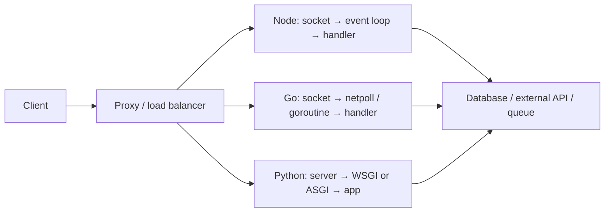

# 04. How servers execute

[README](../README.en.md) · [VI](./04-server-runtime.vi.md) · [EN](./04-server-runtime.en.md)

## Which layers handle a request?

The proxy handles TLS/routing; the server accepts and parses HTTP; middleware handles auth/validation; the handler calls domain logic and I/O; serialization produces the response. Distinguish database waiting from CPU computation: changing runtimes cannot automatically repair slow queries, missing indexes, or connection-pool limits.

## Node: V8, event loop, and libuv

JavaScript callbacks in an ordinary worker execute on one event-loop thread. The process still has other threads. Network I/O commonly uses OS readiness mechanisms; libuv's pool handles selected filesystem, DNS lookup, crypto, and compression APIs. Not every `await` uses that pool. [Node blocking guide](https://nodejs.org/learn/asynchronous-work/dont-block-the-event-loop).

Async I/O waiting lets the loop handle other requests. CPU loops, large JSON operations, or synchronous APIs keep it busy and can increase other requests' latency. Adding `async` does not offload computation. Pool `worker_threads` for JavaScript CPU work; processes/replicas add workers and fault isolation. JavaScript worker threads and libuv's native pool are separate mechanisms. [Worker threads](https://nodejs.org/api/worker_threads.html).

## Go: goroutines, scheduler, and net/http

Handler code can look blocking while network waits park goroutines and let the scheduler run others. The runtime multiplexes goroutines onto OS threads; CPU work can run in parallel. `GOMAXPROCS` bounds simultaneous Go execution, not the total goroutine or OS-thread count. Goroutines still consume resources: bound jobs, queues, and connections. [Runtime](https://pkg.go.dev/runtime#GOMAXPROCS).

`net/http` accepts connections and creates service goroutines; “exactly one goroutine per request” is not a universal rule across protocols. Concurrent handlers can access shared state, so protect mutable maps with a mutex or explicit ownership. Use the race detector for shared-state code. [net/http](https://pkg.go.dev/net/http#Server.Serve), [race detector](https://go.dev/doc/articles/race_detector).

Go 1.25+ adds default GOMAXPROCS behavior aware of CPU affinity/cgroup quota. The declared `go.mod` language version and GODEBUG affect compatibility; language versions ≤1.24 can retain older defaults. This repository declares 1.22 as its code baseline, so do not assume the new-module quota behavior. Explicit GOMAXPROCS also affects automatic updates. Inspect the actual container configuration. [Container-aware GOMAXPROCS](https://go.dev/blog/container-aware-gomaxprocs).

## Python: which “core” is commonly used?

**CPython** is the implementation discussed here. In its ordinary GIL-enabled build, only one thread executes Python bytecode at a time per interpreter. Threads remain useful for I/O, and native libraries may release the GIL. Pure-Python CPU work commonly uses process pools or a separate compute service. This does not mean a Python system can use only one CPU. [threading](https://docs.python.org/3.14/library/threading.html).

Optional free-threaded builds exist since 3.13; that does not mean every Python has removed the GIL. Unsupported extensions can re-enable it. Check dependency compatibility and measure behavior. An `asyncio` loop still executes one task at a time on its loop thread; free-threading does not make CPU coroutines parallel automatically. [Free threading](https://docs.python.org/3.14/howto/free-threading-python.html), [asyncio](https://docs.python.org/3.14/library/asyncio-task.html).

| Component | Role | Misconception to avoid |
| --- | --- | --- |
| CPython | Python bytecode execution and object/memory management | Not a web framework |
| asyncio | Coroutines, tasks, event loop, async I/O | Does not offload synchronous functions automatically |
| WSGI | Synchronous server/application interface | Does not mandate a single thread/process model |
| ASGI | Async `scope, receive, send` interface, HTTP/WebSocket/lifespan | An interface, not a server |
| Uvicorn | ASGI server: sockets, HTTP parsing, loop, worker manager | Neither FastAPI nor the uv package manager |
| Gunicorn | UNIX master/worker server; concurrency depends on worker class | Sync WSGI workers do not run ASGI automatically |
| Starlette / FastAPI | Routing, middleware, responses; FastAPI adds validation/OpenAPI | `async def` can still block through sync I/O |
| Django / Flask | Web frameworks with different deployment interfaces | Flask async views do not turn WSGI into ASGI |

Interface sources: [WSGI / PEP 3333](https://peps.python.org/pep-3333/), [ASGI](https://asgi.readthedocs.io/en/latest/specs/main.html).

Uvicorn `--workers N` creates separate processes, each with its own loop and memory. Reload and workers are mutually exclusive. `uvicorn.workers` is deprecated; Gunicorn + ASGI integrations should use the separate `uvicorn-worker` package. Gunicorn's default sync worker handles one request at a time per process; gthread and async workers change execution behavior. [Uvicorn deployment](https://uvicorn.dev/deployment/), [Gunicorn design](https://gunicorn.org/design/).

FastAPI runs `def` routes/dependencies in a thread pool; directly called synchronous helpers inside `async def` are not automatically offloaded. Flask async views retain their WSGI worker for the request. Django supports ASGI/async, but synchronous middleware and transactions need attention; Django 5.2, for example, does not support async transactions. [FastAPI concurrency](https://fastapi.tiangolo.com/async/), [Flask async](https://flask.palletsprojects.com/en/stable/async-await/), [Django 5.2 async](https://docs.djangoproject.com/en/5.2/topics/async/).

## Operational comparison

| Situation | Node.js | Go | Python |
| --- | --- | --- | --- |
| Many requests waiting on APIs | Async clients with concurrency bounds | Goroutines + contexts + pools | ASGI + async clients + semaphores |
| CPU work in handlers | Can block that worker's loop | Can run in parallel but competes for CPU | Blocks the async loop; GIL affects pure-Python CPU threads |
| Multiple CPUs | More processes or a worker-thread pool | One process can use multiple CPUs | More processes; native/free-threaded behavior depends on workload |
| In-memory state | Processes/replicas do not share it automatically | Goroutines in one process can share it | Processes do not share automatically; threads/tasks can |
| Cancellation | Signals need cooperating APIs | Contexts must propagate | Task cancellation needs awaits/cooperating APIs |
| Shutdown | Stop admission and drain requests with deadlines | Server.Shutdown with context; handle hijacked connections separately | Lifespan and worker shutdown; queues need their own draining design |

Every stack needs outbound timeouts, pool limits, bounded queues, graceful shutdown, and metrics. Backpressure means accepting, delaying, or rejecting work when resources run out; it takes more than `async` or extra workers. Retry design needs idempotency and total deadlines. Before adding workers, count total database connections as replicas × workers × pool size.
