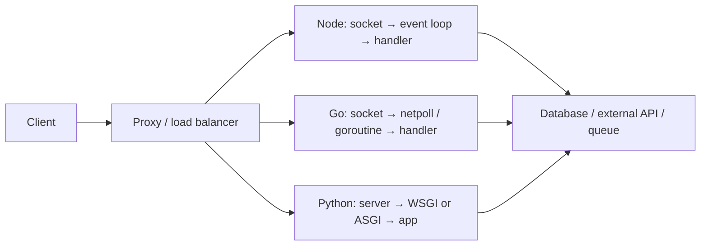
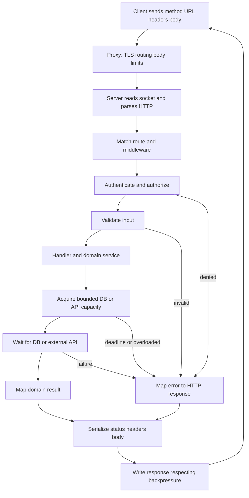
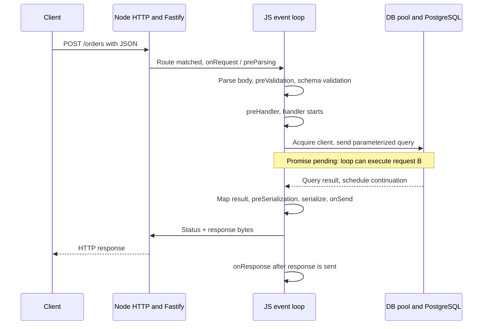
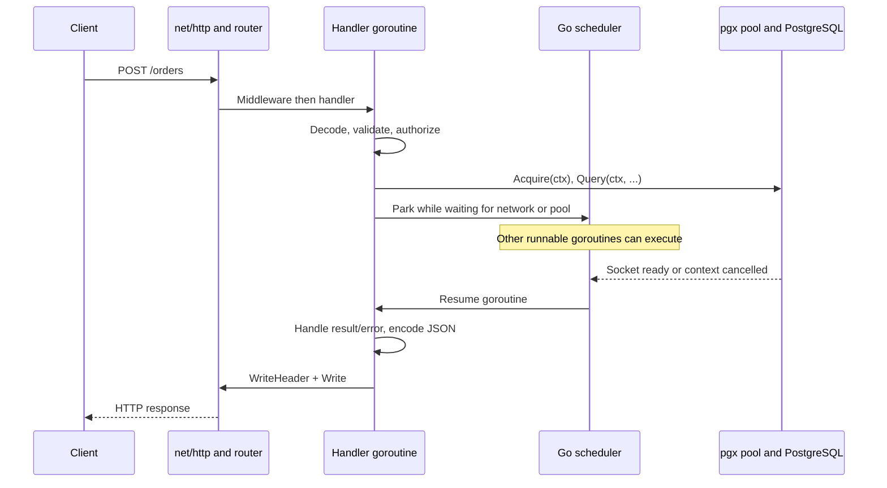
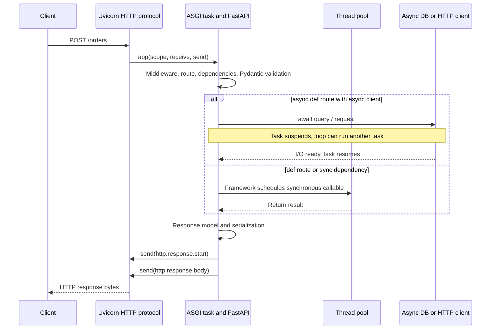
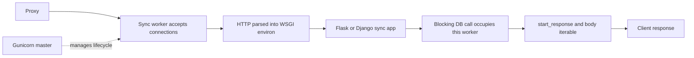

# 04. How servers execute

[README](../README.en.md) · [VI](./04-server-runtime.vi.md) · [EN](./04-server-runtime.en.md)

## Which layers handle a request?

The proxy handles TLS/routing; the server accepts and parses HTTP; middleware handles auth/validation; the handler calls domain logic and I/O; serialization produces the response. Distinguish database waiting from CPU computation: changing runtimes cannot automatically repair slow queries, missing indexes, or connection-pool limits.

## Node: V8, event loop, and libuv

JavaScript callbacks in an ordinary worker execute on one event-loop thread. The process still has other threads. Network I/O commonly uses OS readiness mechanisms; libuv's pool handles selected filesystem, DNS lookup, crypto, and compression APIs. Not every `await` uses that pool. [Node blocking guide](https://nodejs.org/learn/asynchronous-work/dont-block-the-event-loop).

Async I/O waiting lets the loop handle other requests. CPU loops, large JSON operations, or synchronous APIs keep it busy and can increase other requests' latency. Adding `async` does not offload computation. Pool `worker_threads` for JavaScript CPU work; processes/replicas add workers and fault isolation. JavaScript worker threads and libuv's native pool are separate mechanisms. [Worker threads](https://nodejs.org/api/worker_threads.html).

## Go: goroutines, scheduler, and net/http

Handler code can look blocking while network waits park goroutines and let the scheduler run others. The runtime multiplexes goroutines onto OS threads; CPU work can run in parallel. `GOMAXPROCS` bounds simultaneous Go execution, not the total goroutine or OS-thread count. Goroutines still consume resources: bound jobs, queues, and connections. [Runtime](https://pkg.go.dev/runtime#GOMAXPROCS).

`net/http` accepts connections and creates service goroutines; “exactly one goroutine per request” is not a universal rule across protocols. Concurrent handlers can access shared state, so protect mutable maps with a mutex or explicit ownership. Use the race detector for shared-state code. [net/http](https://pkg.go.dev/net/http#Server.Serve), [race detector](https://go.dev/doc/articles/race_detector).

Go 1.25+ adds default GOMAXPROCS behavior aware of CPU affinity/cgroup quota. The declared `go.mod` language version and GODEBUG affect compatibility; language versions ≤1.24 can retain older defaults. This repository declares 1.22 as its code baseline, so do not assume the new-module quota behavior. Explicit GOMAXPROCS also affects automatic updates. Inspect the actual container configuration. [Container-aware GOMAXPROCS](https://go.dev/blog/container-aware-gomaxprocs).

## Python: which “core” is commonly used?

**CPython** is the implementation discussed here. In its ordinary GIL-enabled build, only one thread executes Python bytecode at a time per interpreter. Threads remain useful for I/O, and native libraries may release the GIL. Pure-Python CPU work commonly uses process pools or a separate compute service. This does not mean a Python system can use only one CPU. [threading](https://docs.python.org/3.14/library/threading.html).

Optional free-threaded builds exist since 3.13; that does not mean every Python has removed the GIL. Unsupported extensions can re-enable it. Check dependency compatibility and measure behavior. An `asyncio` loop still executes one task at a time on its loop thread; free-threading does not make CPU coroutines parallel automatically. [Free threading](https://docs.python.org/3.14/howto/free-threading-python.html), [asyncio](https://docs.python.org/3.14/library/asyncio-task.html).

| Component | Role | Misconception to avoid |
| --- | --- | --- |
| CPython | Python bytecode execution and object/memory management | Not a web framework |
| asyncio | Coroutines, tasks, event loop, async I/O | Does not offload synchronous functions automatically |
| WSGI | Synchronous server/application interface | Does not mandate a single thread/process model |
| ASGI | Async `scope, receive, send` interface, HTTP/WebSocket/lifespan | An interface, not a server |
| Uvicorn | ASGI server: sockets, HTTP parsing, loop, worker manager | Neither FastAPI nor the uv package manager |
| Gunicorn | UNIX master/worker server; concurrency depends on worker class | Sync WSGI workers do not run ASGI automatically |
| Starlette / FastAPI | Routing, middleware, responses; FastAPI adds validation/OpenAPI | `async def` can still block through sync I/O |
| Django / Flask | Web frameworks with different deployment interfaces | Flask async views do not turn WSGI into ASGI |

Interface sources: [WSGI / PEP 3333](https://peps.python.org/pep-3333/), [ASGI](https://asgi.readthedocs.io/en/latest/specs/main.html).

Uvicorn `--workers N` creates separate processes, each with its own loop and memory. Reload and workers are mutually exclusive. `uvicorn.workers` is deprecated; Gunicorn + ASGI integrations should use the separate `uvicorn-worker` package. Gunicorn's default sync worker handles one request at a time per process; gthread and async workers change execution behavior. [Uvicorn deployment](https://uvicorn.dev/deployment/), [Gunicorn design](https://gunicorn.org/design/).

FastAPI runs `def` routes/dependencies in a thread pool; directly called synchronous helpers inside `async def` are not automatically offloaded. Flask async views retain their WSGI worker for the request. Django supports ASGI/async, but synchronous middleware and transactions need attention; Django 5.2, for example, does not support async transactions. [FastAPI concurrency](https://fastapi.tiangolo.com/async/), [Flask async](https://flask.palletsprojects.com/en/stable/async-await/), [Django 5.2 async](https://docs.djangoproject.com/en/5.2/topics/async/).

## Operational comparison

| Situation | Node.js | Go | Python |
| --- | --- | --- | --- |
| Many requests waiting on APIs | Async clients with concurrency bounds | Goroutines + contexts + pools | ASGI + async clients + semaphores |
| CPU work in handlers | Can block that worker's loop | Can run in parallel but competes for CPU | Blocks the async loop; GIL affects pure-Python CPU threads |
| Multiple CPUs | More processes or a worker-thread pool | One process can use multiple CPUs | More processes; native/free-threaded behavior depends on workload |
| In-memory state | Processes/replicas do not share it automatically | Goroutines in one process can share it | Processes do not share automatically; threads/tasks can |
| Cancellation | Signals need cooperating APIs | Contexts must propagate | Task cancellation needs awaits/cooperating APIs |
| Shutdown | Stop admission and drain requests with deadlines | Server.Shutdown with context; handle hijacked connections separately | Lifespan and worker shutdown; queues need their own draining design |

Every stack needs outbound timeouts, pool limits, bounded queues, graceful shutdown, and metrics. Backpressure means accepting, delaying, or rejecting work when resources run out; it takes more than `async` or extra workers. Retry design needs idempotency and total deadlines. Before adding workers, count total database connections as replicas × workers × pool size.

## Follow a request from arrival to response

The example is `POST /orders`: receive JSON, check access, write PostgreSQL, return `201`. This is an implementable architecture; exact middleware ordering depends on the framework and configuration. A proxy may buffer bodies/responses; receiving headers does not mean the client has received the complete body.

### Node.js + Fastify: where does `await` yield?

Fastify matches the route before `onRequest` and `preParsing`; `onRequest` cannot read a parsed body. Header-based authentication can run there; body-dependent authentication needs a later stage. Default validation uses JSON Schema/Ajv, not Zod automatically. The handler has a pending Promise while the DB works, allowing the loop to execute other callbacks. When the result arrives, its continuation executes JavaScript on the loop again. [Fastify lifecycle](https://fastify.dev/docs/latest/Reference/Lifecycle/).

Large `JSON.stringify` operations or CPU work before/after `await` can still delay other requests. Exhausted DB pools add waiting; more Node workers can multiply connections and overload the DB. Bound body size, pool acquisition time, and total deadlines; measure event-loop lag alongside query time.

For NestJS, the usual order is **middleware → guards → inbound interceptors → pipes → controller/service → outbound interceptors**. Exception filters handle uncaught exceptions; they are not a mandatory successful-response stage. Guards enforce access; pipes transform/validate input. [Nest lifecycle](https://docs.nestjs.com/faq/request-lifecycle).

### Go + net/http/chi: sequential-looking code, concurrent progress

`Query(ctx, ...)` looks blocking, but a network wait typically parks the goroutine so the scheduler can execute other work. Pool acquisition can also wait and needs a deadline. Propagate `r.Context()` through DB and outbound HTTP calls; creating `context.Background()` in a service cuts the request cancellation chain. The driver must cooperate for cancellation to take effect. [Context](https://pkg.go.dev/context), [pgxpool](https://pkg.go.dev/github.com/jackc/pgx/v5/pgxpool).

The diagram shows a handler goroutine, not a guarantee that each request creates exactly one goroutine. HTTP/1 keep-alive reuses connections; HTTP/2 multiplexes streams on a connection. Shared maps require mutexes or ownership design regardless of network waits. CPU work can run in parallel, but competes for the same CPU budget.

### Python + Uvicorn/FastAPI: ASGI task, thread pool, async DB

Uvicorn supplies an HTTP scope and `receive/send` to the ASGI app. FastAPI/Starlette handle routing, dependencies, and responses; ordering details depend on middleware/dependency placement. An `async def` route should use an async driver, such as SQLAlchemy async with `asyncpg`, or `httpx.AsyncClient`. Direct calls to `requests.get()`, `time.sleep()`, or synchronous helpers hold the loop. Framework-declared `def` routes/dependencies are scheduled in a thread pool; directly called helpers are not automatically offloaded. [FastAPI concurrency](https://fastapi.tiangolo.com/async/), [ASGI HTTP](https://asgi.readthedocs.io/en/latest/specs/www.html).

The thread pool is bounded; switching to `def` does not create unlimited throughput. SQLAlchemy `AsyncSession` holds transaction state: concurrent tasks need separate sessions. Load a large ML model once during startup/lifespan rather than on every request; multiple processes hold separate model/memory copies. [SQLAlchemy async sessions](https://docs.sqlalchemy.org/en/20/orm/extensions/asyncio.html).

### Python + Gunicorn sync/WSGI: where is a worker occupied?

The master manages process lifecycles; its arrow represents management, not application-handler execution. One sync worker handles one request at a time. A blocking DB wait occupies that worker; other workers can still operate. `gthread` provides threads per worker; ASGI needs a compatible server/worker. This configuration does not imply Flask, Django, or Python always run sequentially. [Gunicorn design](https://gunicorn.org/design/), [WSGI](https://peps.python.org/pep-3333/).

## Same scenario: A waits 100 ms, B computes a sum

| Moment | Node async | Go network wait | Python ASGI async | Gunicorn sync, 1 worker |
| --- | --- | --- | --- | --- |
| A starts waiting on I/O | Handler yields loop | Goroutine parks | Task yields loop | Worker remains occupied |
| B arrives | Loop can handle B | Another goroutine can run B | Loop can handle B | B waits for a worker |
| A's I/O finishes | Continuation scheduled | Goroutine runnable again | Task scheduled | Worker continues A |

This explains concurrency rather than measuring latency. If A runs CPU work instead of I/O, Node/Python async hold their loop; Go competes for CPU budget. If B also needs an exhausted DB pool, all three can wait.

## Timeout, disconnect, backpressure, shutdown

1. **Deadline:** define a total request budget, then allocate pool/query/API budgets; individual timeouts do not automatically impose a total deadline.
2. **Disconnect:** detect client closure and propagate cancellation to cooperating calls. Sent responses cannot be recalled; committed queries do not roll back automatically because a client left.
3. **Backpressure:** bound active and queued work, reject overload appropriately, or move long jobs to a queue. Streaming must respect transport write capacity rather than buffer unlimited chunks.
4. **Shutdown:** remove readiness/stop admission, drain in-flight requests with a deadline, then close pools/consumers. Queued jobs need their own retry/idempotency design.

Correlate metrics with one request ID: proxy, route, pool acquisition, DB/API, serialization times; active requests, pool waiters, event-loop lag or scheduler/CPU, RSS, and timeout errors. A high p95/p99 does not identify a language as the cause.
