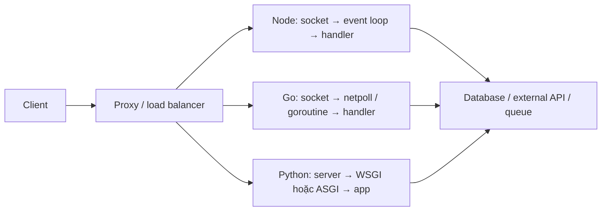

# 04. Server hoạt động như thế nào

[README](../README.vi.md) · [VI](./04-server-runtime.vi.md) · [EN](./04-server-runtime.en.md)

## Request đi qua những lớp nào?

Proxy nhận TLS/routing; server nhận và parse HTTP; middleware xử lý auth/validation; handler gọi domain logic và I/O; serializer tạo response. Chỗ chờ database và chỗ tính toán CPU cần được phân biệt: thay runtime sẽ không tự sửa query chậm, thiếu index hoặc giới hạn connection pool.

## Node: V8, event loop và libuv

Trong một worker thông thường, callback JavaScript chạy trên một thread event loop. Process vẫn có thread khác. Network I/O thường dùng cơ chế readiness của OS; libuv worker pool dùng cho một số API như filesystem, DNS lookup, crypto và compression. Không phải mọi `await` đều chạy trên worker pool. [Node blocking guide](https://nodejs.org/learn/asynchronous-work/dont-block-the-event-loop).

Khi chờ I/O async, callback có thể nhường loop để xử lý request khác. Vòng lặp CPU, JSON lớn hoặc API sync giữ loop bận và làm request khác tăng latency. Thêm `async` trước hàm không offload phần tính toán. Dùng pool `worker_threads` cho CPU JavaScript; child process/replica dùng để tăng số worker và cô lập lỗi. Worker thread JS và native pool libuv là hai cơ chế khác nhau. [Worker threads](https://nodejs.org/api/worker_threads.html).

## Go: goroutine, scheduler và net/http

Code handler có thể trông như blocking, nhưng network wait có thể park goroutine để scheduler chạy goroutine khác. Runtime ghép goroutine lên OS thread; CPU work có thể chạy song song. `GOMAXPROCS` giới hạn mức thực thi Go đồng thời, không giới hạn tổng số goroutine hay OS thread. Goroutine không miễn phí: cần giới hạn job, queue và connection. [Runtime](https://pkg.go.dev/runtime#GOMAXPROCS).

`net/http` nhận connection và tạo service goroutine; không nên học thuộc “mỗi request đúng một goroutine” cho mọi giao thức. Các handler có thể truy cập dữ liệu dùng chung đồng thời; bảo vệ mutable map bằng mutex hoặc thiết kế ownership. Chạy race detector khi có shared state. [net/http](https://pkg.go.dev/net/http#Server.Serve), [race detector](https://go.dev/doc/articles/race_detector).

Go 1.25+ có mặc định GOMAXPROCS nhận biết CPU affinity/cgroup quota. Hành vi phụ thuộc phiên bản khai báo trong `go.mod` và GODEBUG; mốc ngôn ngữ ≤1.24 có thể giữ mặc định cũ. Repo này khai báo 1.22 để thể hiện mức code yêu cầu, nên không giả định tự nhận quota như module mới. Đặt `GOMAXPROCS` tường minh cũng ảnh hưởng tự cập nhật. Kiểm tra cấu hình thực tế trong container. [Container-aware GOMAXPROCS](https://go.dev/blog/container-aware-gomaxprocs).

## Python: “core” nào thường dùng?

**CPython** là implementation đang được bàn ở đây. Với build GIL mặc định, trong một interpreter chỉ một thread thực thi Python bytecode tại một thời điểm. Thread vẫn hữu ích cho I/O; thư viện native có thể giải phóng GIL. CPU thuần Python thường dùng process pool hoặc service compute riêng. Không suy ra rằng cả hệ thống Python chỉ dùng được một CPU. [threading](https://docs.python.org/3.14/library/threading.html).

Python có build free-threaded tùy chọn từ 3.13; không có nghĩa mọi Python đã bỏ GIL. Extension không hỗ trợ có thể bật GIL trở lại. Cần kiểm tra compatibility của dependency và đo thực tế. Một event loop `asyncio` vẫn chạy từng task trên thread loop; free-threading không tự biến coroutine CPU thành chạy song song. [Free threading](https://docs.python.org/3.14/howto/free-threading-python.html), [asyncio](https://docs.python.org/3.14/library/asyncio-task.html).

| Thành phần | Vai trò | Nhầm lẫn cần tránh |
| --- | --- | --- |
| CPython | Chạy Python bytecode, quản lý object/memory | Không phải web framework |
| asyncio | Coroutine, task, event loop, async I/O | Không tự chuyển hàm sync sang thread |
| WSGI | Interface đồng bộ giữa server và app | Không quy định duy nhất mô hình thread/process |
| ASGI | Interface async `scope, receive, send`, HTTP/WebSocket/lifespan | Là interface, không phải server |
| Uvicorn | ASGI server; socket, HTTP parsing, loop, worker manager | Không phải FastAPI và không phải uv package manager |
| Gunicorn | UNIX master/worker server; worker class quyết định concurrency | Worker WSGI sync không tự chạy ASGI |
| Starlette / FastAPI | Routing, middleware, response; FastAPI thêm validation/OpenAPI | `async def` vẫn có thể block nếu gọi I/O sync |
| Django / Flask | Framework web; deployment interface tùy framework | Flask async view không biến WSGI thành ASGI |

Nguồn interface: [WSGI / PEP 3333](https://peps.python.org/pep-3333/), [ASGI](https://asgi.readthedocs.io/en/latest/specs/main.html).

Uvicorn `--workers N` tạo nhiều process; mỗi process có loop và memory riêng. `--reload` và `--workers` không dùng cùng nhau. `uvicorn.workers` đã deprecated; nếu cần Gunicorn + ASGI, dùng package `uvicorn-worker` riêng. Gunicorn sync worker mặc định xử lý một request tại một thời điểm trong một process; gthread và async worker thay đổi cách thực thi. [Uvicorn deployment](https://uvicorn.dev/deployment/), [Gunicorn design](https://gunicorn.org/design/).

FastAPI đưa route/dependency khai báo `def` qua thread pool; helper sync gọi trực tiếp bên trong `async def` không tự được offload. Flask async view vẫn giữ WSGI worker trong suốt request. Django hỗ trợ ASGI/async nhưng sync middleware và transaction cần xem xét; ví dụ Django 5.2 chưa hỗ trợ transaction async. [FastAPI concurrency](https://fastapi.tiangolo.com/async/), [Flask async](https://flask.palletsprojects.com/en/stable/async-await/), [Django 5.2 async](https://docs.djangoproject.com/en/5.2/topics/async/).

## So sánh vận hành

| Tình huống | Node.js | Go | Python |
| --- | --- | --- | --- |
| Nhiều request chờ API | Async client, giới hạn concurrency | Goroutine + context + pool | ASGI + async client, semaphore |
| CPU work trong handler | Có thể chặn loop của worker | Có thể chạy song song nhưng tranh CPU với request khác | Chặn async loop; GIL ảnh hưởng thread CPU thuần Python |
| Scale trên nhiều CPU | Nhiều process hoặc worker thread pool | Một process có thể dùng nhiều CPU | Nhiều process; native/free-threaded tùy workload |
| State trong memory | Replica/process không tự chia sẻ | Goroutine cùng process có thể chia sẻ | Process không tự chia sẻ; thread/task có thể chia sẻ |
| Hủy công việc | Signal cần API hợp tác | Context cần được truyền xuống | Task cancellation cần await/API hợp tác |
| Shutdown | Ngừng nhận và drain request; deadline | Server.Shutdown + context; xử lý connection hijacked riêng | Lifespan + worker shutdown; drain queue tùy thiết kế |

Mọi stack đều cần timeout outbound, pool limit, queue bound, graceful shutdown và metric. Backpressure là quyết định nhận/hoãn/từ chối công việc khi tài nguyên hết; không chỉ là thêm `async` hoặc thêm worker. Với retry, tính cả idempotency và tổng deadline. Đếm số connection database trên toàn bộ replica × worker × pool trước khi tăng worker.
