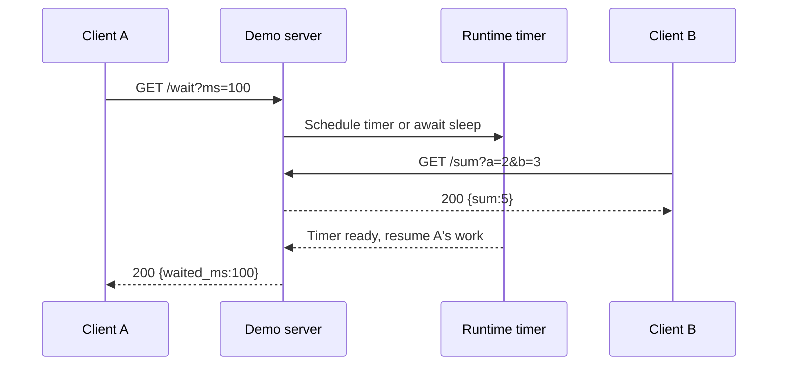

# 05. Three servers, one API

[README](../README.en.md) · [VI](./05-server-examples.vi.md) · [EN](./05-server-examples.en.md)

## Shared contract

The servers bind `127.0.0.1` for local demonstrations. They teach runtime behavior and do not include a database, authentication, rate limiting, or a production middleware stack.

| Request | Status | JSON |
| --- | --- | --- |
| `GET /health` | 200 | `{"ok":true}` |
| `GET /sum?a=2&b=3` | 200 | `{"sum":5}` |
| `GET /wait?ms=100` | 200 | `{"waited_ms":100}` |
| `GET /wait` | 200 | `{"waited_ms":50}` |
| Invalid or missing required query | 400 | `{"error":"invalid_query"}` |
| Unknown route | 404 | `{"error":"not_found"}` |
| Non-GET method | 405, `Allow: GET` | `{"error":"method_not_allowed"}` |

Query integers must use ASCII form `-?(0|[1-9][0-9]*)`, at most 8 characters. `a` and `b` range from -1,000,000 to 1,000,000; `ms` ranges from 0 to 1000. Whitespace, empty strings, decimals, exponents, and leading zeroes are rejected. `-0` is accepted. Repeated keys use the first value; unknown keys are ignored. For `/sum` and `/wait`, the whole query must have valid percent escapes and no unencoded `;`; `%3B` remains value data. Compare decoded JSON, not key order or whitespace. HEAD has no response body under HTTP semantics, even though the handler returns 405.

## Install and run

From the repository directory, create a Python environment and install dependencies:

```sh
python3 -m venv .venv
.venv/bin/python -m pip install -r examples/server/python/requirements.txt
```

Open three separate terminals:

```sh
node examples/server/node/main.mjs
# http://127.0.0.1:3000
```

```sh
go run ./examples/server/go
# http://127.0.0.1:3001
```

```sh
.venv/bin/python examples/server/python/main.py
# http://127.0.0.1:3002
```

```sh
curl 'http://127.0.0.1:3000/sum?a=2&b=3'
curl 'http://127.0.0.1:3001/wait?ms=100'
curl 'http://127.0.0.1:3002/health'
```

Set `PORT=...` before a command to change a busy port. Windows uses `.venv\Scripts\python.exe`; the check script manages POSIX process groups, so run the full check suite on Linux/macOS or WSL.

## Read the waiting handlers

- [Node source](../examples/server/node/main.mjs): `setTimeout` schedules the response while the callback returns to the loop. Closing the client connection clears its timer through the response `close` event.
- [Go source](../examples/server/go/main.go): timer + select on request context can park the goroutine. Client cancellation can end waiting through that context.
- [Python source](../examples/server/python/main.py): `await asyncio.sleep` yields the loop and the app emits ASGI events through `send`. Uvicorn owns sockets, HTTP parsing, and the loop. The demonstration does not receive `http.disconnect` during sleep, so its early cancellation differs from Node/Go.

Direct ASGI makes the interface visible; practical apps usually use FastAPI or Starlette for maintainable routing, validation, exception handling, and lifespan hooks. Uvicorn explicitly uses asyncio + h11, without needing uvloop/httptools.

## Verify behavior

```sh
.venv/bin/python scripts/check.py
go vet ./...
go run -race ./examples/concurrency/go
```

Checks cover the 21 syntax JSON fields, a concurrency cap of 2, all three HTTP servers, boundary/invalid inputs, methods, and overlapping requests. The script builds the Go server, selects temporary ports, starts processes, and cleans them up. Startup and requests have timeouts. Overlapping requests have no throughput/latency threshold, so this is not a benchmark.

## Multiple Python workers

```sh
.venv/bin/python -m uvicorn main:app \
  --app-dir examples/server/python \
  --host 127.0.0.1 --port 3002 --workers 2 \
  --loop asyncio --http h11
```

Each worker is a separate process. Reload and workers cannot be combined; a cache in one worker is not automatically synchronized with other workers. Reload is a development feature. Deployment needs workload-appropriate proxy/TLS, body limits, timeouts, monitoring, authentication, and shutdown behavior.

Sources: [Node HTTP](https://nodejs.org/api/http.html), [Go HTTP](https://pkg.go.dev/net/http), [ASGI HTTP spec](https://asgi.readthedocs.io/en/latest/specs/www.html), [Uvicorn settings](https://uvicorn.dev/settings/).

## Request flow in these exact demos



This is one possible ordering when B arrives while A waits. Scheduling does not guarantee B always finishes first. `/wait` simulates I/O with a timer and uses no DB; `/sum` performs tiny CPU work with synchronous validation.

| Step | Node | Go | Python |
| --- | --- | --- | --- |
| Receive request | `http.createServer` callback | `ServeHTTP` handler | Uvicorn calls `app(scope, receive, send)` |
| Read path/query | URL + raw query checks | URL + `url.ParseQuery` | Decoded ASGI path + raw query bytes + parsing |
| Validate | Regex + bounds | Regex + bounds | Regex + bounds |
| `/wait` | `setTimeout` callback | Timer + context `select` | `await asyncio.sleep` |
| Return JSON | `res.end` | `WriteHeader`, encoder | ASGI start/body events |
| Early client close | Clear timer on `close` | Context ends | Demo does not read disconnect during sleep |

Call `/sum` while `/wait` runs from two terminals, then replace the timer with CPU work on an experimental branch to observe the difference. Keep that CPU loop out of the real server. Observe CPU and aggregate request time; one laptop run cannot rank runtimes.

## From demos to application stacks

See [Node stacks](guides/node-stacks.en.md), [Go stacks](guides/go-stacks.en.md), and [Python backend](guides/python-backend.en.md) for routing, validation, databases, transactions, queues, and observability. Recipes state their own dependencies/prerequisites; they do not change the three demos' contracts.
