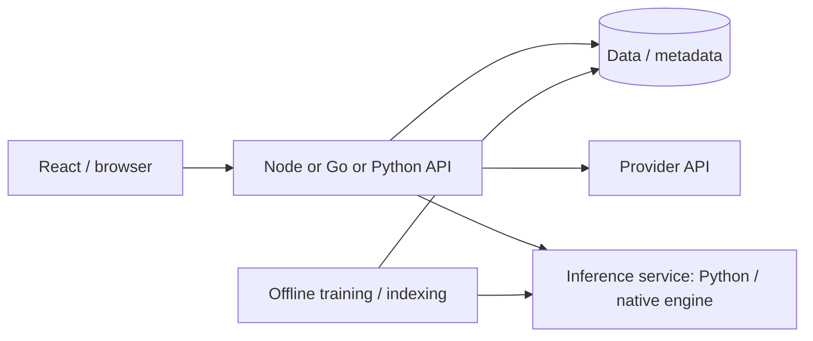
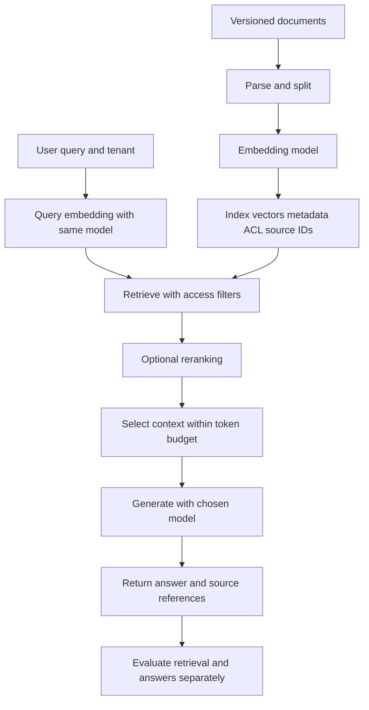
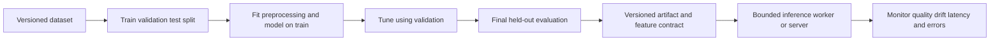

# 07. AI, ML and model serving

[README](../README.en.md) · [VI](./07-ai-platforms.vi.md) · [EN](./07-ai-platforms.en.md)

## AI libraries belong to different layers

| Layer | Examples | Responsibility | Does not automatically provide |
| --- | --- | --- | --- |
| Provider SDK | OpenAI Node/Go/Python SDKs | Requests, streaming, response decoding | Local training, GPU scheduling, agent policy |
| Application/orchestration | AI SDK, LangChain, Genkit | Tool inputs, workflows, streaming, model integration | Model quality, tool authorization |
| Agent execution | [LangGraph](https://docs.langchain.com/oss/python/langgraph/overview) | State, checkpoints, durable execution/human-in-loop as designed | Correct business reasoning or automatic safety guarantees |
| Data/classical ML | NumPy, pandas, scikit-learn | Data processing and traditional ML | Complete LLM serving infrastructure |
| Tensors/training | PyTorch, TensorFlow, JAX | Arrays/tensors, differentiation, accelerators | API gateways, auth, tenant budgets |
| Model definitions/workflows | Transformers, Keras | Pretrained models or high-level model building | Default optimized serving/admission control |
| Inference serving | vLLM, Ollama, ONNX Runtime as appropriate | Model execution, batching/engines/APIs by tool | The whole business application |

See the [catalog](./06-ecosystem.en.md) for provider/framework sources. These are architecture layers, not quality or popularity rankings.

## Additional AI platforms

| Tool / source | Strengths and fit | Limitations / assessment |
| --- | --- | --- |
| [TensorFlow](https://www.tensorflow.org/guide) | Tensors/autodiff, data pipelines, accelerators, and training/export/serving ecosystem; suits an established TensorFlow workflow. | Do not switch stacks solely for a ranking. Check models, devices, export formats, and deployment requirements. |
| [Keras 3](https://keras.io/) | High-level deep learning with TensorFlow/JAX/PyTorch backends makes model building/training accessible. | Multi-backend does not make all custom code/operators portable. Choose compatible backend APIs and avoid mixing Keras 2/3 tutorials. |
| [JAX](https://docs.jax.dev/en/latest/) | Arrays, autodiff, JIT, and transformations support numerical research/accelerators. | Requires functional, shape, and compilation concepts. Neither an HTTP framework nor mandatory for every ML app. |
| [ONNX Runtime](https://onnxruntime.ai/docs/) | Model engine with hardware-specific execution providers and Node/Python bindings across environments. | Verify export/operator support and numerical parity. Check individual Go bindings rather than assuming an equivalent official SDK. |
| [Ollama](https://docs.ollama.com/) | Runs supported models behind APIs, useful for local development and experimentation. | Plan RAM/VRAM, licenses, and resource controls; a local experience is not a production benchmark. |

## Where do Node, Go, and Python fit?

**Node/TypeScript** suits products with chat UI, browser streaming, and API-hosted models. Teams can share types/schemas across frontend/backend work. AI SDK or provider SDKs reduce integration code. Large tensor workloads often use a separate inference service; that does not imply JavaScript lacks local inference.

**Go** can serve as a gateway or integration service: requests, auth, quotas, model routing, streaming, and monitoring. Official provider SDKs exist. If research/training uses Python, calling that service over HTTP/gRPC is an architectural option. Balance the additional service cost against isolation/scaling needs.

**Python** suits preprocessing, model definitions, training, and inference workflows. FastAPI can wrap a model or call async provider clients. Model computation often uses native CPU/GPU code, so the GIL alone does not explain inference performance. Do not load a large model separately in every HTTP worker without calculating total memory and GPU contention.

These are architecture assessments about ecosystems and integration, not language benchmark conclusions.

## Example mixed architecture

A product does not need all three languages. Start with a stack the team understands; split compute/inference when hardware, scaling, or ownership justify it. The gateway may be Python and the inference server may rely on a native engine. “Go backend” and “Python model” describe roles rather than absolute restrictions.

## RAG: assess each step separately

1. Ingest/chunk documents while retaining sources, versions, and access rights.
2. Embed with the selected model/tokenizer and store vectors plus metadata.
3. Retrieve with permission filters; evaluate recall and relevance.
4. Build context within a token budget, call the model, and stream results.
5. Measure groundedness, citations, latency, and cost on real questions.

LangChain/Genkit connect steps but do not replace data design, permission filters, or evaluation. Vector stores are a different infrastructure layer from LLM SDKs. Changing an embedding model usually requires re-embedding or an explicit migration strategy; simply changing a model name does not make existing incompatible vectors valid.

## How AI differs from CRUD requests

| Factor | What to measure / design |
| --- | --- |
| Latency | Time to first token, total duration, generation rate; separate queue wait from model execution. |
| Memory | Weights + activations/KV cache + batching + workers; inspect RAM and VRAM. |
| Throughput | Concurrent requests, token budgets, batch policies; tokens/sec does not establish output quality. |
| Cancellation | Stop upstream computation after clients abandon streams when APIs support it; avoid orphaned work. |
| Retries | Do not casually replay side-effectful tools; timeouts after commits can cause duplicates. |
| Tool calling | Validate inputs, authorize per user, and bound tool budgets. Model outputs are inputs to the application. |
| Quality | Golden datasets, regression evaluation, task-specific metrics, and citations. |
| Cost | Tokens, embeddings, GPU time, and storage; budgets per tenant/request. |

This repository calls no paid APIs and downloads no models. Links support further learning/selection; verify capabilities and hardware support for each release/model.

## RAG and ML flows from data to responses

Index/query need a compatible, versioned embedding model/contract in the same vector space, with matching dimensions and normalization. Apply model-prescribed query/document preprocessing and prompts, which may differ; apply ACL filters before context reaches the model. Citations provide inspectable sources rather than proof of correctness. Deletions/updates must change the index accordingly. Side-effecting tools need user authorization and backend input validation. [Semantic search](https://www.sbert.net/examples/sentence_transformer/applications/semantic-search/README.html).

Reserve final test data rather than repeatedly using it to choose hyperparameters. Artifacts carry feature order/types and preprocessing; serving versions need matching contracts. [Python AI/ML](guides/python-ai-ml.en.md) contains 31 profiles and three detailed pipelines; [Python data](guides/python-data.en.md) contains 12 profiles and an offline lab. [Node](guides/node-stacks.en.md)/[Go](guides/go-stacks.en.md) explain gateway/application integration.
