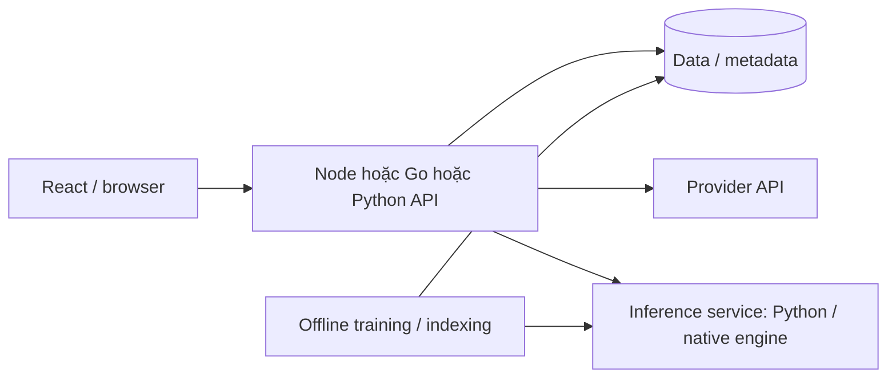
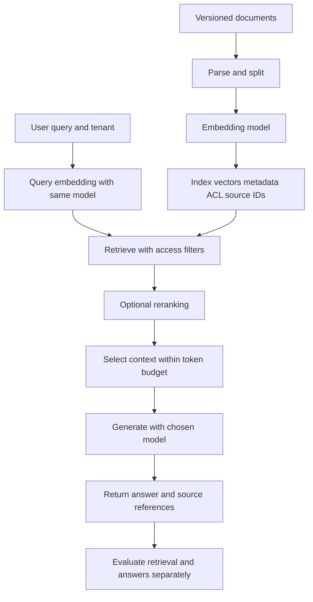
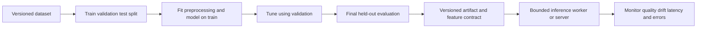

# 07. AI, ML và nền tảng phục vụ mô hình

[README](../README.vi.md) · [VI](./07-ai-platforms.vi.md) · [EN](./07-ai-platforms.en.md)

## Không đặt mọi thư viện AI vào cùng một nhóm

| Lớp | Ví dụ | Làm gì | Không tự cung cấp |
| --- | --- | --- | --- |
| Provider SDK | OpenAI SDK Node/Go/Python | Gửi request, stream, deserialize response | Training local, GPU scheduling, agent policy |
| Application/orchestration | AI SDK, LangChain, Genkit | Tool input, workflow, streaming, model integration | Model quality, quyền thực thi tool |
| Agent execution | [LangGraph](https://docs.langchain.com/oss/python/langgraph/overview) | State, checkpoint, durable execution/human-in-loop theo thiết kế | Tự hiểu đúng business và tự bảo đảm an toàn |
| Data/classical ML | NumPy, pandas, scikit-learn | Xử lý dữ liệu và mô hình ML truyền thống | Hệ thống serving LLM hoàn chỉnh |
| Tensor/training | PyTorch, TensorFlow, JAX | Array/tensor, differentiation, accelerator | API gateway, auth, tenant budget |
| Model definition/workflow | Transformers, Keras | Pretrained model hoặc API xây model cấp cao | Admission control/serving tối ưu mặc định |
| Inference serving | vLLM, Ollama, ONNX Runtime tùy model | Chạy model, batching/engine/API theo tool | Toàn bộ application business |

Nguồn provider và framework xem [catalog](./06-ecosystem.vi.md). Vai trò trong bảng là phân lớp kiến trúc, không phải thứ hạng chất lượng hay mức phổ biến.

## Các nền tảng AI bổ sung

| Công cụ / nguồn | Điểm mạnh và khi dùng | Giới hạn / đánh giá |
| --- | --- | --- |
| [TensorFlow](https://www.tensorflow.org/guide) | Tensor/autodiff, data pipeline, accelerator và hệ sinh thái training/export/serving. Hợp team đã có workflow TensorFlow. | Không đổi stack chỉ vì một bảng xếp hạng. Kiểm tra model, device, export format và yêu cầu deployment cụ thể. |
| [Keras 3](https://keras.io/) | API deep learning cấp cao, backend TensorFlow/JAX/PyTorch; giúp mô hình và training loop dễ tiếp cận. | Multi-backend không có nghĩa mọi code/custom op portable. Chọn backend và API tương thích, đừng trộn tutorial Keras 2/3. |
| [JAX](https://docs.jax.dev/en/latest/) | Array computation, autodiff, JIT và transformations cho numerical research/accelerator. | Cần tư duy functional, shape và compilation. Không phải framework HTTP hay lựa chọn bắt buộc cho mọi ML app. |
| [ONNX Runtime](https://onnxruntime.ai/docs/) | Engine chạy model với execution provider theo hardware; có binding Node/Python và nhiều môi trường. | Export/operator support và numerical parity phải kiểm tra. Go integration cần xác minh binding cụ thể; đừng mặc định có official SDK tương đương. |
| [Ollama](https://docs.ollama.com/) | Chạy model và gọi qua API; tiện phát triển local và thử model được hỗ trợ. | Cần RAM/VRAM, model license và resource control; trải nghiệm local không thay benchmark production. |

## Node, Go và Python đứng ở đâu?

**Node/TypeScript** phù hợp khi sản phẩm có UI chat, stream tới browser và dùng model qua API. Có thể chia sẻ kiểu/schema trong team frontend/backend. AI SDK hoặc provider SDK giảm code integration. Tác vụ tensor lớn thường giao cho service inference riêng; không suy ra JavaScript không có local inference.

**Go** phù hợp làm gateway hoặc service kết nối: nhận request, auth, quota, route tới model, stream response và giám sát. Official provider SDK đã tồn tại. Nếu nghiên cứu/training đang dùng Python, Go gọi service đó qua HTTP/gRPC là lựa chọn kiến trúc có thể xem xét. Chi phí thêm service phải được cân bằng với nhu cầu isolation/scale.

**Python** phù hợp khi logic ở gần preprocessing, model definition, training và inference ecosystem. FastAPI có thể bọc model hoặc gọi provider async. Model compute thường chạy native CPU/GPU; vì vậy GIL không đủ để giải thích hiệu năng inference. Đừng load model lớn riêng cho từng HTTP worker mà chưa tính tổng memory và GPU contention.

Đây là đánh giá kiến trúc theo hệ sinh thái và cách tích hợp, không phải kết luận benchmark giữa ngôn ngữ.

## Ví dụ kiến trúc hỗn hợp

Không cần cả ba ngôn ngữ trong một sản phẩm. Bắt đầu với stack team hiểu, tách compute/inference khi hardware, scaling hoặc ownership có lý do rõ ràng. Gateway có thể là Python; inference server có thể dùng engine native phía dưới. “Backend bằng Go” và “model bằng Python” mô tả vai trò, không tạo ràng buộc tuyệt đối.

## RAG: các bước cần đánh giá riêng

1. Ingest tài liệu, chia đoạn, giữ nguồn/version và quyền truy cập.
2. Tạo embedding theo model/tokenizer đã chọn; lưu vector và metadata.
3. Retrieve với filter quyền truy cập; đánh giá recall và độ liên quan.
4. Ghép context trong token budget; gọi model và stream kết quả.
5. Kiểm tra groundedness, citation, latency và chi phí trên bộ câu hỏi thật.

LangChain/Genkit hỗ trợ nối các bước, nhưng không thay thiết kế dữ liệu, permission filter và evaluation. Vector store là hạ tầng khác lớp với LLM SDK. Index đổi embedding model thường cần re-embedding hoặc chiến lược chuyển đổi; đừng chỉ đổi tên model ở request và dùng lại vector không tương thích.

## Tác vụ AI chạy khác API CRUD thế nào?

| Yếu tố | Điều cần đo / thiết kế |
| --- | --- |
| Latency | Time to first token, tổng thời gian, tốc độ sinh token; tách chờ queue với chạy model. |
| Memory | Model weights + activation/KV cache + batching + nhiều worker; kiểm tra RAM và VRAM. |
| Throughput | Concurrent request, token budget, batch policy; token/sec không thay chất lượng output. |
| Cancellation | Client bỏ stream thì dừng upstream compute nếu API hỗ trợ; tránh công việc mồ côi. |
| Retry | Không replay tool có side effect tùy tiện; timeout sau commit có thể tạo tác vụ trùng. |
| Tool calling | Validate input, kiểm tra quyền theo user và giới hạn tool budget. Model output là dữ liệu đầu vào. |
| Quality | Golden dataset, regression evaluation, kiểm tra task-specific metric và citation. |
| Cost | Token, embedding, GPU time và lưu trữ; budget theo tenant/request. |

Repo này không gọi API trả phí hoặc tải model. Các nguồn model/framework được link để lựa chọn và học thêm; capability và hardware support cần kiểm tra theo release/model cụ thể.

## Luồng RAG và ML từ dữ liệu tới response

Index/query cần embedding model/contract có version tương thích trong cùng vector space, đúng dimension và normalization. Dùng preprocessing/prompt riêng cho query/document nếu model yêu cầu; ACL filter làm trước khi model thấy context. Citation là source reference để kiểm tra, không tự chứng minh answer đúng. Xóa/cập nhật nguồn phải cập nhật index tương ứng. Tool call với side effect cần quyền của user và input validation ở backend. [Semantic search](https://www.sbert.net/examples/sentence_transformer/applications/semantic-search/README.html).

Final test được giữ riêng, không dùng lặp lại để chọn hyperparameter. Artifact chứa feature order/types và preprocessing; serving version phải đi cùng contract. [Python AI/ML](guides/python-ai-ml.vi.md) có 31 profile và ba pipeline chi tiết; [Python data](guides/python-data.vi.md) có 12 profile và lab offline. [Node](guides/node-stacks.vi.md)/[Go](guides/go-stacks.vi.md) mô tả gateway/app integration.
